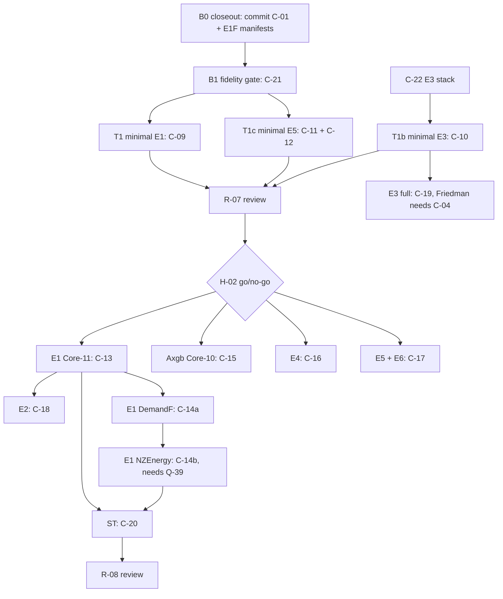

# SGBR Reproduction Plan and Matrix

**Version:** 1.0 (proposal for review) · **Date:** 2026-11-21 · **Author:** Claude (Research Scientist) · **Implementer:** Codex · **Approver:** Human

This document turns `docs/paper_spec.md` and `docs/experiment_plan.md` into a cell-level matrix Codex can schedule. It does **not** change the approved protocol (H-01, 2026-11-19). Items marked **[ADAPT-pending]** take effect only after human approval (AGENTS.md). Nothing in here is a result. No experiment was launched to write it.

### Tags

| Tag | Meaning |
|---|---|
| **[P p.N]** | Paper fact, journal page N of 37 (Tab./Fig./Eq. given where relevant) |
| **[CODE path]** | Fact read from the authors' repo at commit `f62f7b437512e020f57c4bcd03884c4724eda5b1` |
| **[CODE-INF]** | Inference from code that was not executed |
| **[INF]** | Our derivation (e.g. arithmetic on paper tables) |
| **[EXT]** | External or general knowledge, to be verified |
| **[KAGGLE]** | Observation from our own Kaggle runs (human-reported until the manifest is committed) |
| **[ADAPT-ok]** | Deviation from the original, already approved (Decisions log in `tasks.md`) |
| **[ADAPT-pending]** | Proposed deviation awaiting approval |
| **[UNRESOLVED U-n]** | Not determinable from paper or code. See §10 |

**Normative source for commands:** the JSON configs at the pinned commit. If a string in this document disagrees with the JSON, the JSON wins and this document has a bug.

---

## 1. Starting point (as of 2026-11-21)

| Item | State | Evidence |
|---|---|---|
| C-01 Kaggle environment | Reported complete by the human. Kaggle CPU, Java 11 (the notebook default is Temurin 11.0.29+7) | [KAGGLE]; `docs/kaggle_environment_audit.md` |
| JDK 8 | **Cannot build the pinned module.** MEKA 1.9.7's `meka.core.F` is Java 11 bytecode (class version 55) | Codex audit, "Notebook validation". The paper states JDK 1.8.0 **[P p.34]**: see U-1 |
| E1 memory-feasibility cell | NZEnergy × Sgb(Arf) × seed 1, `-Xmx16g`: **completed**, 3,100,666 instances | [KAGGLE], human-reported |
| Authors' value for that exact cell | R̄² = **0.9741708731300197**, wall = **7,408.09 s**, 3,100,666 instances | [CODE exp/post_hoc_new/NZEnergy_1/SGBT(ARF).csv] |
| `results/manifest/environment.json`, `e1_memory_feasibility.json` | **Committed and pushed** | Commit `9c06a16` |

**What the feasibility run establishes:**
- One E1 cell of about 2 h at paper speed completes in a single Kaggle session.
- Sgb(Arf) on NZEnergy fits in 16 GiB.

**What it does not establish:**
- Memory for the other 12 methods. The paper says every method except Sgb(Oza) needed 48 GB in E1 **[P p.34]**, and it does not say on which datasets.
- The Kaggle slowdown factor, until the wall time is reported.
- Numerical parity, until its final R̄² is compared with 0.9741708731300197.

**B0 closeout (required before B1, §11):** commit both manifests and report three numbers from them: final R̄², `wall_clock_seconds` and `peak_java_rss_bytes`.

**B0 verification (2026-11-21):**
- C-01 and E1 manifests committed and pushed: `9c06a16`.
- E1 status: completed; exit code: 0.
- Classified instances: 3,100,666.
- Adjusted R²: 0.9741708731300197.
- Authors' adjusted R²: 0.9741708731300197.
- Absolute delta: 0 (exact match).
- Wall clock: 6255.82919224 seconds.
- Peak Java RSS: 2280615936 bytes (~2.12 GiB).
- B0 numerical parity: PASS.
---

## 2. Experiment inventory (Matrix A)

| ID | Paper artefacts | Claims tested (plan §1) | Datasets | Methods | Seeds × reps | Evaluator | JVM | Authors' config | Reference targets | Specification status |
|---|---|---|---|---|---|---|---|---|---|---|
| **E1** Main comparison | Tab.3 p.15, Tab.4 p.17, Tab.8 pp.25–26, Tab.9 pp.27–28, Figs.4–5 p.18 | C1–C5 | All-16 (13 available) | 13 (§4.1) | 1–5 [P p.34] | `EvaluatePrequentialRegression -e BasicRegressionPerformanceEvaluator -f 10000000 -q 10000000` | `-Xmx48g -Xms50m -Xss1g` | `exp/exp_config.json` | Per-seed: `exp/post_hoc_new` (6 methods). Mean ± std: Tabs.3, 4, 8, 9 | Fully specified by code |
| **E2** Drift behaviour | Fig.6 p.18 | C10 | HyperA | Sgb(Oza), SOKNL, ArfReg, OzaReg | 1–3 [P p.34; CODE] | `… -e (WindowRegressionPerformanceEvaluator -w 10000) -f 10000 -q 10000` | `-Xmx12g -Xms50m -Xss1g` | `exp/exp_config_overTime.json` | Fig.6 is a plot only; no numeric table | Fully specified by code. Target is visual |
| **E3** Bias–variance | Fig.2 p.9, Fig.7 p.19, Fig.8 p.20 | C6 | BV-10 = Core-11 − HyperA [P p.16] | Sgbt ("B"), Sgb(Oza) E=5 ("BB"), Oza(Sgbt) E=5 ("BagB") | mlxtend `random_seed=42`, `num_rounds=10` | CapyMOA + `mlxtend.bias_variance_decomp(loss='mse')` | Not stated | `exp/Bias_Variance_Decomp/BVDecompSyntheticLatest.py` | `exp/Bias_Variance_Decomp/RESULTS/*.csv` (raw curves) | Partly: Friedman\* split files missing (U-5); CapyMOA version unknown (U-6) |
| **E4** lr × feature % | Fig.9 p.20 | C7 | Core-11 | Sgb(Oza)(10,10), 9 configs (§4.3) | 1–5 [CODE LR_FP config] | `… -e BasicRegressionPerformanceEvaluator` (default sampling) | `-Xmx12g …` | `exp/exp_config_SGBT_OZA_parameter_search_LR_FP.json` | Fig.9 only (plot-read values, plan §5.2) | Fully specified by code. Hardware unknown (Q-24) |
| **E5** Steps × bag size | Tab.5 p.22, Tab.6 p.23, Tab.10 p.29, Tab.11 p.30, Fig.10 p.21 | C8 | Core-11 | Sgb(Oza), 9 (S, E) configs (§4.3) | 1–5 [P p.34; CODE] | as E4 | `-Xmx12g …` | `exp/exp_config_SGBT_OZA_parameter_search.json` | Tabs.5, 6, 10, 11 | Fully specified by code |
| **E6** Best configs vs baselines | Tab.7 p.24, Tab.12 pp.31–32 | C9 | Core-11 | Sgb(Oza)(5,20), (10,10), SOKNL, OzaReg, ArfReg | 1–5 [P p.34] | as E5 [CODE-INF] | `-Xmx12g` [P p.34] | Sgb(Oza) from E5 config; **baseline config not in repo** | Tabs.7, 12 | Partly (U-3) |
| **E0** Motivation | Tab.1 p.7 | (context only) | Core-11 | Sgbt(100 steps), FIRT-DD, HTR, SGT | Not stated (Q-24) | Not in repo | Not stated | **None in repo** | Tab.1 | Partly (U-2, Q-03) |
| **ST** Significance | Figs.4–5 p.18 | C3, C4 | E1 outputs | Oza(Sgbt), Sgb(Oza), Sgb(Arf), SOKNL, OzaReg, ArfReg | — | Friedman + Shaffer, α = 0.05 [P p.16] | — | Inputs only: `exp/post_hoc_new` | Figs.4–5 | Partly: tool not in repo (Q-22) |

**Out of scope:** `exp/exp_config_OZA_SGBT_parameter_search.json`, an Oza(Sgbt) (E, S) grid that the paper does not report [CODE].

**Dataset subsets** (plan §2.1):
- **Core-11:** Fried, House8L, Abalone, Bike, Elevators, MetroTraffic, Ailerons, FriedmanLea, FriedmanGra, FriedmanGsg, HyperA. This matches the `datasets` list in the E4/E5 configs [CODE].
- **Core-10:** Core-11 without HyperA.
- **BV-10:** Core-11 without HyperA [P p.16].

---

## 3. Datasets (Matrix B)

Counts come from Tab.2 p.13 and the repo [CODE exp/RDatasets/; spec §11.6]. Only HyperA and NZEnergy have drift points stated in the paper [P pp.11–12].

| Dataset | Features (Tab.2) | Instances (Tab.2) | MOA-processed rows (repo) | Nominal attrs | Type | Repo file | Available | Used in |
|---|---|---|---|---|---|---|---|---|
| Fried | 10 | 40,768 | 40,768 | 0 | Synthetic | `fried.arff` | ✔ | E0 E1 E3 E4 E5 E6 |
| House8L | 8 | 22,784 | 22,784 | 0 | Real | `House8L.arff` | ✔ | E0 E1 E3 E4 E5 E6 |
| Abalone | 8 | 4,977 | 4,977 | 0 | Real (anonymised repo version, not raw UCI; Q-02) | `abalone.arff` | ✔ | E0 E1 E3 E4 E5 E6 |
| Bike | 12 | 17,379 | 17,379 | 0 | Real | `bike.arff` | ✔ | E0 E1 E3 E4 E5 E6 |
| Elevators | 18 | 16,599 | 16,599 | 0 | Synthetic | `elevators.arff` | ✔ | E0 E1 E3 E4 E5 E6 |
| MetroTraffic | 7 | 48,204 | 48,204 | 0 | Real | `MetroTraffic.arff` | ✔ | E0 E1 E3 E4 E5 E6 |
| Ailerons | 40 | 13,750 | 13,750 | 0 | Synthetic | `ailerons.arff` | ✔ | E0 E1 E3 E4 E5 E6 |
| FriedmanLea | 10 | 100,000 | 100,000 | 0 | Synthetic, local abrupt drift | `FriedmanLea.arff` | ✔ (E3 split files ✘, U-5) | E0 E1 E3 E4 E5 E6 |
| FriedmanGra | 10 | 100,000 | 100,000 | 0 | Synthetic, global recurring abrupt | `FriedmanGra.arff` | ✔ (E3 split files ✘) | E0 E1 E3 E4 E5 E6 |
| FriedmanGsg | 10 | 100,000 | 100,000 | 0 | Synthetic, global slow gradual | `FriedmanGsg.arff` | ✔ (E3 split files ✘) | E0 E1 E3 E4 E5 E6 |
| HyperA | 10 | 500,000 | 500,000 | 0 | Synthetic, 3 abrupt drifts (125k/250k/375k) | `hyperA.arff.zip` | ✔ | E0 E1 E2 E4 E5 E6 |
| DemandF | 8 | 150,150 | 150,150 | 2 (store_id, sku_id) | Real | `DemandF.arff.zip` | ✔ | E1 |
| NZEnergy | 12 | 3,100,660 | **3,100,666** (also observed on Kaggle) | 1 (PoC) | Real, seasonal | `NZEnergy.arff.zip` | ✔ | E1 |
| SUP2I | 80 | 100,000 | — | — | Synthetic (GAN), incremental | — | ✘ (H-04) | E1 |
| SUP3A | 81 | 200,000 | — | — | Synthetic (GAN), abrupt | — | ✘ (H-04) | E1 |
| SUP3G | 81 | 200,000 | — | — | Synthetic (GAN), gradual | — | ✘ (H-04) | E1 |

**Rules for Codex:**
- Use the repo bytes only, and record a SHA-256 of each uncompressed file.
- The MOA-processed row count must equal the column above, which is our pass criterion. The NZEnergy +6 offset against Tab.2 is a known, reported discrepancy.
- Do not regenerate synthetic streams (generator parameters are unknown, Q-19).

---

## 4. Algorithms and exact hyperparameters

`F` := `trees.FIMTDD -s VarianceReductionSplitCriterion -g 50 -c 0.01 -e`. The effective component defaults (OzaBag λ = 1 hard-coded, ARF/SRP/SOKNL 60 % subspace and λ = 6, FIMTDD Page-Hinkley settings, HTR grace 200 / confidence 1e-7) are listed in `paper_spec.md` §11.2 and are **not overridden anywhere**.

### 4.1 E1 learners [CODE exp/exp_config.json]

| Paper name | Authors' label (use as `method_key`) | MOA learner string | Seed flag |
|---|---|---|---|
| Oza(Sgbt) | `Oza(SGBT(FIRTDD))` | `meta.OzaBag -s 10 -l (meta.StreamingGradientBoostedTrees -t -L 1.0 -m 75 -s 10 -l (F))` | `-Z <seed>` |
| Srp(Sgbt) | `SRP(SGBT(FIRTDD))` | `meta.StreamingRandomPatches -s 10 -l (meta.StreamingGradientBoostedTrees -t -L 1.0 -m 75 -s 10 -l (F))` | `-Z` |
| Sgb(Oza) | `SGBT(Oza(FIRTDD))` | `meta.StreamingGradientBoostedTrees -t -L 1.0 -m 75 -s 10 -l (meta.OzaBag -s 10 -l (F))` | `-Z` |
| Sgb(Arf) | `SGBT(ARFReg(FIRTDD))` | `meta.StreamingGradientBoostedTrees -t -L 1.0 -m 75 -s 10 -l (meta.AdaptiveRandomForestRegressor -s 10 -x (ADWINChangeDetector -a 0.001) -p (ADWINChangeDetector -a 0.01))` | `-Z` |
| Sgb(Srp) | `SGBT(SRP(FIRTDD))` | `meta.StreamingGradientBoostedTrees -t -L 1.0 -m 75 -s 10 -l (meta.StreamingRandomPatches -s 10 -l (F))` | `-Z` |
| OzaReg | `Oza(FIRTDD)` | `meta.OzaBag -s 100 -l (F)` | `-Z` |
| ArfReg | `ARFReg(FIRTDD)` | `meta.AdaptiveRandomForestRegressor -s 100 -x (ADWINChangeDetector -a 0.001) -p (ADWINChangeDetector -a 0.01)` | `-Z` |
| SOKNL | `SOKNL(FIRTDD)` | `meta.SelfOptimisingKNearestLeaves -s 100 -l (SelfOptimisingBaseTree -s VarianceReductionSplitCriterion -g 50 -c 0.01) -x (ADWINChangeDetector -a 0.001) -p (ADWINChangeDetector -a 0.01)` | `-Z` |
| SrpReg | `SRP(FIRTDD)` | `meta.StreamingRandomPatches -s 100 -l (F)` | `-Z` |
| Sgbt | `SGBT(FIRTDD)` | `meta.StreamingGradientBoostedTrees -t -L 1.0 -m 75 -s 100 -l (F)` | `-Z` |
| FIRT-DD | `FIRTDD` | `F` | none |
| HTR | `HT` | `trees.HoeffdingRegressionTree -k -n HoeffdingNumericAttributeClassObserver -d HoeffdingNominalAttributeClassObserver` | none |
| Axgb | `AXGBr` | `meta.AdaptiveXGBoostClassifier -s 10` | none |

**Task template** [CODE exp/benchmark_moa.py:121-160]:

```
java -classpath moa.jar <java_options> moa.DoTask "<evaluator> -s (ArffFileStream -f <dataset>.arff) -l (<learner> [-Z <seed>]) -d <out>.csv"
```

`-Z <seed>` is appended only when the seed column is `Z`, and only to the outermost learner. No stream shuffling, no `-r`.

### 4.2 E2 learners [CODE exp/exp_config_overTime.json]

The four E1 strings for `SGBT(Oza(FIRTDD))`, `SOKNL(FIRTDD)`, `ARFReg(FIRTDD)` and `Oza(FIRTDD)`, unchanged. The evaluator and JVM options are as in Matrix A.

### 4.3 E4 and E5 grids [CODE]

All use `meta.StreamingGradientBoostedTrees -t -L <lr> -m <feat> -s <S> -l (meta.OzaBag -s <E> -l (F))` with `-Z <seed>`.

| Experiment | Label pattern | Grid |
|---|---|---|
| E4 | `SGBT_10_<lr>_<feat>(Oza_10)` | lr ∈ {0.5, 1.0, 1.5} × feat ∈ {25, 75, 100}; S = E = 10 |
| E5 | `SGBT_<S>(Oza_<E>)` | (S, E) ∈ {(1,100), (2,50), (4,25), (5,20), (10,10), (20,5), (25,4), (50,2), (100,1)}; lr 1.0, feat 75 |

**Identity check [INF]:** E1 Sgb(Oza), E4 `SGBT_10_1.0_75` and E5 `SGBT_10(Oza_10)` are the **same learner string**, so on the same seed and dataset they must give the same final R̄². Only the evaluator sampling frequency and heap differ. Codex should run them separately, not deduplicate, and use the equality as a V1 integrity test.

### 4.4 E3 learner strings [CODE BVDecompSyntheticLatest.py:96-115]

These are passed through `SKCapyMOARegressor` for b ∈ {5, 10, …, 100}:

| Method (CSV label) | MOA class | CLI |
|---|---|---|
| Sgbt (`B`) | `StreamingGradientBoostedTrees` | `-t -L 1.0 -m 75 -s {b} -l (F)` |
| Sgb(Oza) (`BB`) | `StreamingGradientBoostedTrees` | `-t -L 1.0 -m 75 -s {b} -l (meta.OzaBag -s 5 -l (F))` |
| Oza(Sgbt) (`BagB`) | `OzaBag` | `-s 5 -l (meta.StreamingGradientBoostedTrees -t -L 1.0 -m 75 -s {b} -l (F))` |

**Protocol** [CODE BVDecompSyntheticLatest.py:36-80]:
- **Non-drift datasets:** `KFold(n_splits=10)` with no shuffle. Per fold, `bias_variance_decomp(model, …, loss='mse', random_seed=42, num_rounds=10)`.
- **Friedman\*:** for each training file `<name>_1 … <name>_10`, test on `<name>_12`, with the same mlxtend call.
- **Aggregation:** mean over folds or files, then √bias and √variance.

In the shipped script, the `B` and `BB` lines are commented out and only `BagB` runs. The `B`/`BB` rows in `RESULTS/BVDecompose_Results_<ds>.csv` were therefore produced with those lines enabled [CODE-INF] (U-7).

### 4.5 E0 learners

Sgbt, FIRT-DD and HTR use the E1 strings, matching the Tab.1 values that coincide with Tab.3 [spec Q-03]. The paper says SGT used "default SGT parameters" [P Tab.1 footnote, p.7]. The only SGT command in the repo is the runner's help example `trees.StreamingGradientTreePredictor`, with no seed [CODE exp/benchmark_moa.py:27] (U-2).

### 4.6 E6 learners

- Sgb(Oza)(5,20) and (10,10) use the E5 strings.
- SOKNL, OzaReg and ArfReg presumably use the E1 strings with E5's evaluator and `-Xmx12g` [CODE-INF]. No config exists (U-3).

---

## 5. Seeds, repetitions and cell counts (Matrix C)

**Seed rules:**
- `-Z <seed>` goes to the outer learner only. Inner learners keep their default seed (K-9).
- Streams are fixed ARFF files, identical across seeds [CODE].
- **One-run rule [ADAPT-ok H-01(f)]:** FIRT-DD, HTR, Axgb (and SGT) receive no seed, so they run once per dataset and that run stands for all seeds, with std = 0. This matches the zero stds in Tabs.8–9 **[P pp.25–28]**.

| Exp | Seeds | Seeded methods | One-run methods | Cells in approved scope (13 datasets, Axgb Core-10) | Cells in paper scope |
|---|---|---|---|---|---|
| E1 | 1–5 | 10 | FIRT-DD, HTR (13 datasets); Axgb (10 datasets) | 10 × 13 × 5 + 2 × 13 + 10 = **686** | 13 × 16 × 5 = 1,040 |
| E2 | 1–3 | 4 | — | 4 × 1 × 3 = **12** | 12 |
| E3 | mlxtend seed 42 | 3 | — | 3 methods × 20 b-values × 10 datasets = **600 points**, each 100 model fits (10 folds or files × 10 rounds) | 600 |
| E4 | 1–5 | 9 configs | — | 9 × 11 × 5 = **495** | 495 |
| E5 | 1–5 | 9 configs | — | 9 × 11 × 5 = **495** | 495 |
| E6 | 1–5 | 2 configs + 3 baselines | — | 0 new cells if E5 and E1 Core-11 run on the same CPU model (§8.3). Otherwise 3 × 11 × 5 = 165 | 275 (incl. E5 rows) |
| E0 | Not stated | — | SGT | 11 (SGT); the rest reuse E1 | 44 |

---

## 6. Metrics

| Metric | Definition (what we must compute) | Source column / tool | Applies to |
|---|---|---|---|
| **R̄² (primary)** | MOA's prequential adjusted R². SS_tot uses the running mean of earlier targets (0 at the first instance), and p = numAttributes **including** the target (K-5, K-6; spec §11.2) | MOA CSV `adjusted coefficient of determination`, **final row** | E1, E4, E5, E6, E0 |
| Windowed R̄² | Same formula over the last 10,000 instances, sampled every 10,000 | MOA CSV, every row | E2 |
| Wall time | MOA internal wall clock; JVM start-up excluded [CODE-INF] | `evaluation time (wall) (seconds)`, final row | E1, E2, E4, E5, E6 |
| Processed instances | Must equal the Matrix B count | `classified instances` | All (integrity) |
| Per-cell summary | mean ± std over seeds. **Which std (n or n−1) is [UNRESOLVED U-8]**: compute both and keep whichever reproduces Tab.8 from `post_hoc_new` | — | Tabs.8–12 |
| Average rank | Rank methods per dataset on the mean (1 = highest R̄² or fastest); average over datasets; tied ranks averaged [ASSUME] | — | Tabs.3–7 |
| Friedman + Shaffer | α = 0.05 [P p.16]. Blocks = (dataset, seed), 80 per method in `post_hoc_new` [CODE-INF]. Also report the per-dataset variant (C-20). Use a reviewed, unit-tested implementation [ADAPT-ok, plan §9] | — | Figs.4–5 |
| √bias, √variance, mean error | mlxtend MSE decomposition, averaged over folds or files, then square-rooted | E3 CSV columns `sqrt_mean_bias`, `sqrt_mean_var`, `mean_error` | E3 |
| Textbook R² (secondary only) | Eq.U-8 with the global mean, labelled as secondary [ADAPT-ok H-01(b)] | Recomputed offline | Optional |

---

## 7. Expected tables and figures (Matrix D)

| Output | Reproduces | Built from | Compared against | Rule (plan §10.3) |
|---|---|---|---|---|
| `summary/E1_r2.csv` → Table R3 | Tab.3 p.15 (+ Tab.8 std) | E1 cells | `post_hoc_new` per seed (6 methods); Tab.3/Tab.8 (7 methods) | V2 tier 1: per-seed \|Δ\| ≤ 0.005. Tier 2: \|Δ mean\| ≤ max(0.03, 2σ) |
| `summary/E1_time.csv` → Table R4 | Tab.4 p.17 (+ Tab.9) | E1 cells | Ratios to OzaReg within one CPU model | V5 (ratios only) |
| `figures/fig4.png`, `fig5.png` | Figs.4–5 p.18 | ST on E1 | Same pairwise significance pattern | V4 (C3, C4) |
| `figures/fig6.png` | Fig.6 p.18 | E2 | Visual: Sgb(Oza) dips less at 125k/250k/375k | V4 (C10), qualitative |
| `figures/fig2.png`, `fig7.png`, `fig8.png` | Figs.2, 7, 8 | E3 | `RESULTS/*.csv`, curve by curve | V6 (qualitative), plus a numeric Δ table for information |
| `figures/fig9.png` + table | Fig.9 p.20 | E4 | Plot-read values (plan §5.2) | V4 (C7). lr 0.5 collapse expected (K-2) |
| `summary/E5_r2.csv`, `E5_time.csv`, `fig10.png` | Tabs.5, 6, 10, 11; Fig.10 | E5 | Tabs.5–6 values and stds | V2 tier 2; V5 |
| `summary/E6.csv` | Tab.7, Tab.12 | E5 + E1 baselines | Tab.7 | V2 tier 2; V5 |
| `summary/E0.csv` | Tab.1 p.7 | E1 reuse + SGT | Tab.1 | Informative only (U-2, Q-03) |
| `summary/claims.md` | C1–C10 verdicts | All | Paper text | V4 |

Every number must trace to a file under `results/`. Cells that did not run are reported as `not run – <reason>`, never imputed and never copied from the paper (plan §10.3).

---

## 8. Computational requirements

### 8.1 Basis

- **Paper-speed CPU-hours** = Σ(per-run wall time × runs). Sources:
  - The 6 methods with raw files: means from `exp/post_hoc_new` [CODE, computed 2026-11-21].
  - The other methods: Tab.4 p.17 means [P].
  - E5: Tab.6 p.23 [P]. E4: Fig.9, plot-read.
- E1 times come from the authors' Xeon 3.7 GHz machine; E5 and E6 from a Ryzen 7 3700X **[P p.34]**.
- All configured learners are single-threaded (`-t`; no `-T` flags) [CODE], so one run uses one core.
- **Kaggle estimate** = σ × CPU-h / c:
  - σ = Kaggle-to-paper slowdown, measured in B0/B1.
  - c = concurrent JVMs, limited by the vCPU count and by RAM ÷ heap (Q-37).
- A single run fits a session only if σ × t_max + export margin ≤ the session limit L (L must come from the C-01 manifest).
- **σ seed value:** Kaggle wall time of the B0 cell ÷ 7,408.09 s.

### 8.2 Requirement table

| Block | Scope | Paper-speed CPU-h | Longest single run (paper) | Paper heap | Kaggle risk |
|---|---|---|---|---|---|
| B1 Fidelity gate | 6 methods × {Abalone, Bike, Elevators} × seeds 1–5 + seed-1 repeat; FIRT-DD/HTR × 2 | **≈ 0.3** | ≈ 21 s (Oza(Sgbt), Elevators) | 48g | None |
| T1 Minimal E1 (C-09) | 8 methods × Core-10 | 4.2 | ≈ 3 min (Oza(Sgbt), Friedman\*) | 48g | Low |
| T1c Minimal E5 (C-11) | 4 configs × Core-10 × 5 | 1.6 (Ryzen) | < 2 min | 12g | Low |
| C-12 lr check | Sgb(Oza) lr 0.5 × 2 datasets | < 0.05 | < 1 min | 12g | None |
| T1b Minimal E3 (C-10) | Sgbt, Ailerons, b ∈ {5, 10, 25, 50, 100} | **Unknown** (measure) | Unknown | Unknown | Python stack (Q-40) |
| E1 Core-11 remainder (C-13) | Srp(Sgbt), Sgb(Arf), Sgb(Srp), SrpReg on Core-10, plus all 12 seeded/unseeded methods on HyperA | 17.7 | 2.8e3 s (Srp(Sgbt), HyperA) | 48g | Low |
| Axgb (C-15) | Core-10 × 1 run | 2.9 | 3.7e3 s (FriedmanLea) | 48g | JNI loading (R-8 in the C-01 review) |
| E1 DemandF (C-14a) | 12 methods × 5 | 4.2 | 1.0e3 s (Srp(Sgbt)) | 48g | Memory unknown |
| **E1 NZEnergy (C-14b)** | 12 methods × 5 | **115.5** | **2.3e4 s Sgb(Srp)** (Tab.9 std ≈ 9.8e3), 2.2e4 s Srp(Sgbt), 9.0e3 s Oza(Sgbt) | 48g | **High:** session limit (Q-39) and memory |
| E1 SUP\* | Only if H-04 delivers | 91.2 | 6.6e3 s (Srp(Sgbt), SUP3A) | 48g | Data |
| E4 (C-16) | 9 × Core-11 × 5 | ≈ 6.8 [INF, plot-read] | HyperA; per-dataset times not tabulated | 12g | Low |
| E5 full (C-17) | 9 × Core-11 × 5 | 7.2 (Ryzen) | 349 s (HyperA, (1,100)) | 12g | Low |
| E6 (C-17) | Reuse, or 3 × Core-11 × 5 | 0, or 5.0 | 1.2e3 s (SOKNL, HyperA) | 12g | Low |
| E2 (C-18) | 4 × HyperA × 3 | 2.3 | 1.2e3 s (SOKNL) | 12g | Low |
| E3 full (C-19) | 3 × 20 × BV-10 (7 if no Friedman splits) | Unknown | Unknown | Unknown | Stack, data (U-5, U-6) |
| E0 SGT | 11 × 1 | Unknown (not in Tab.4) | Unknown | Not stated | Low |

**Totals, approved scope (13 datasets, Axgb Core-10, without E3 and E0): ≈ 161 paper-speed CPU-h.**
- E1: 141.6 h (Core-10 8.0, HyperA 13.9, DemandF 4.2, NZEnergy 115.5)
- Axgb: 2.9 h
- E4: 6.8 h
- E5: 7.2 h
- E2: 2.3 h

NZEnergy is **72 %** of the total. Everything except NZEnergy is ≈ 45 CPU-h. With paper scope plus SUP\*, the total rises to ≈ 252 CPU-h. All figures are [INF].

### 8.3 Constraints that bind on Kaggle

1. **Memory per JVM.** The only measured points are Sgb(Oza) ≤ 12 GB in E1 **[P p.34]** and Sgb(Arf) NZEnergy ≤ 16 GiB [KAGGLE]. For every other E1 method on large datasets, the requirement is **unknown**. Plan for 48g-class runs one at a time, record peak RSS, and treat an OOM as `not run – OOM`.
2. **Session limit vs a single run.** MOA has no checkpointing. If L = 12 h [EXT], Srp(Sgbt) and Sgb(Srp) on NZEnergy cannot finish in one session once σ exceeds about 1.8. The slower Sgb(Srp) seeds (Tab.9 std ≈ 9.8e3 s) fail at a lower σ (Q-39).
3. **CPU model drift.** Separate Kaggle sessions may land on different CPU models [EXT]. Wall-time ratios (V5) are valid only among cells with the same `cpu_model`. E6 reuse of E1 baselines is allowed only under that condition.
4. **Concurrency.** Running c > 1 JVMs changes per-run wall time. Compute V5 ratios only within one concurrency level, and record `concurrency` per cell.

---

## 9. Exact reproduction vs adaptations (register)

**Exact core (what "exact reproduction" means here):**
- Same jar source (pinned commit, authors' Maven goals).
- Same learner strings, evaluator strings, seeds, stream bytes and order.
- Same metric (MOA R̄²).

Anything below is a deviation from the paper's original setting.

| ID | Item | Paper / authors | This reproduction | Effect on comparability | Status |
|---|---|---|---|---|---|
| A-1 | JDK | JDK 1.8.0 **[P p.34]** | JDK 11 (Temurin 11.0.29+7); the pinned module does not compile on JDK 8 (audit) | R̄² expected identical (`java.util.Random` is specified; single-threaded) [INF]; **B1 tests this**. GC default differs (G1 vs Parallel), so absolute wall time differs | **[ADAPT-pending] Q-38**: forced by evidence; needs sign-off; contingent on B1 |
| A-2 | E1 heap | `-Xmx48g` | `-Xmx16g` (feasibility cell); smaller for small datasets under concurrency | No R̄² effect unless OOM; wall time may change (GC pressure; SGBT calls `System.gc()` every 1,000 instances) | **[ADAPT-pending] Q-37** |
| A-3 | Hardware | Xeon / Ryzen / MacBook / EPYC by experiment **[P p.34]** | Kaggle CPU (model recorded per cell) | Absolute seconds not comparable; ratios only | [ADAPT-ok] V5 |
| A-4 | Parallel execution | Sequential runner [CODE] | Parallel independent JVMs | Wall time per run (§8.3.4); no R̄² effect | [ADAPT-ok] plan §6 |
| A-5 | One-run rule | 5 seeds for all methods | 1 run for unseeded learners | None if deterministic (B1 verifies) | [ADAPT-ok] H-01(f) |
| A-6 | Axgb scope | 16 datasets | Core-10, 1 run | Tab.3 Axgb row partial | [ADAPT-ok] H-01(f) |
| A-7 | SUP\* | Included | Absent unless H-04 delivers | Averages and ranks over 13 datasets, not 16. Report both the paper's 16-dataset values and the paper's values recomputed on our 13 | [ADAPT-ok] H-01(d) |
| A-8 | Session limit | None | Cells that cannot finish → `not run – session limit`, or a disclosed non-Kaggle machine | Coverage of NZEnergy | **[ADAPT-pending] Q-39** |
| A-9 | Minimal-tier subsets | Full grids | T1b iterations {5, 10, 25, 50, 100}; T1c 4 of 9 (S, E) configs | Partial claim tests only | [ADAPT-ok] H-01(e) |
| A-10 | E3 drift splits | `<name>_1…_10`, `_12` from unknown generator settings | Regenerate only if approved; otherwise E3 covers 7 datasets | Fig.7 Friedman\* panels | **[ADAPT-pending] Q-31 / C-04** |
| A-11 | E3 software | CapyMOA (version unknown) + repo jar + mlxtend (version unknown) | Versions selected in C-22 | Possibly small numeric differences in mlxtend bootstrap | **[UNRESOLVED U-6] Q-40** |
| A-12 | E6 baselines | Re-run on Ryzen hardware (implied by Tab.7 ≠ Tab.4 times, Q-27) | Reuse E1 cells when on the same CPU model | None for R̄² (same strings and seeds) | [ADAPT-pending] (new; low risk) |
| A-13 | Shaffer test | Tool unknown | Reviewed implementation with unit tests | Possible p-value differences | [ADAPT-ok] plan §9 |
| A-14 | Faithful-to-code conflicts K-1…K-10 | Paper text | Code behaviour (e.g. HTR defaults, lr at training only) | Reported, not corrected | [ADAPT-ok] H-01(b) |

---

## 10. Unresolved items

Do not guess these. Implement the stated fallback and label the output.

| ID | Unresolved | Why it matters | Fallback until resolved | Tracked as |
|---|---|---|---|---|
| U-1 | The paper says JDK 1.8.0, but the pinned code needs Java ≥ 11 to build (MEKA bytecode 55). How did the authors build and run it? | Fidelity claim for A-1 | JDK 11; B1 parity decides | **Q-41** (new) |
| U-2 | Tab.1 (E0): no config; seeds, hardware and SGT command not given | E0 fidelity | SGT = `trees.StreamingGradientTreePredictor`; E0 labelled informative | **Q-42** (new), Q-03, Q-24 |
| U-3 | Tab.7 (E6) baselines: no config; evaluator and heap inferred | E6 fidelity | E1 strings, E5 evaluator, `-Xmx12g` [CODE-INF] | **Q-43** (new) |
| U-4 | SUP2I/3A/3G data | E1 coverage | `not run – data unavailable` | Q-30, H-04 |
| U-5 | Friedman\* bias–variance split files and generator settings | Fig.7 (3 panels) | E3 on 7 datasets | Q-31 |
| U-6 | CapyMOA and mlxtend versions used by the authors | E3 numeric agreement | Choose in C-22; compare to `RESULTS` | Q-40 |
| U-7 | The shipped E3 script runs only `BagB`; how `B`/`BB` were produced (same script with lines enabled?) | E3 Sgbt and Sgb(Oza) curves | Enable the commented lines verbatim [CODE-INF] | **Q-44** (new) |
| U-8 | Std estimator (population or sample) in Tabs.8–12 | V2 tier 2 tolerance | Compute both; select by matching Tab.8 from `post_hoc_new` | **Q-45** (new) |
| U-9 | Paper p.16 says one bias–variance iteration per drift training file; the code runs `num_rounds=10` bootstrap rounds per file | E3 interpretation | Follow the code (H-01(b)) | **Q-46** (new) |
| U-10 | Fig.9 and Tab.1 hardware (and therefore wall-time basis) | E4/E0 time comparisons | Ratios within our runs only | Q-24 |
| U-11 | HyperA Tab.1 vs Tab.3 discrepancy | E0 only | Report | Q-03 |
| U-12 | Memory needed by each E1 method on DemandF/NZEnergy | Scheduling | Measure; 1 JVM at a time | Q-37 |
| U-13 | Kaggle session limit, CPU model, σ | All scheduling | From committed manifests | B0 closeout |

---

## 11. Execution priority and dependencies



| Priority | Batch | Tasks | Depends on | Gate to pass before the next batch | Paper-speed CPU-h |
|---|---|---|---|---|---|
| P0 | **B0 closeout** | C-01 manifest commit; E1 feasibility manifest | — | Manifests in repo; B0 R̄² compared with 0.9741708731 | 0 |
| **P1** | **B1 Fidelity gate** | **C-21** (subsumes C-02, C-07) | B0 | §12 decision rule | ≈ 0.3 |
| P2 | T1, T1c, C-12 | C-09, C-11, C-12 | B1 pass | V1–V3 on Core-10 | 5.8 |
| P2 (parallel track) | E3 stack + T1b | C-22, C-10 | — (independent of B1) | Ailerons `B` curve vs `RESULTS` | Unknown |
| P2 | Review | R-07, H-02 | above | Human go/no-go | — |
| P3 | Cheap full blocks | C-13, C-15, C-16, C-17, C-18 | H-02 | Per-block V2/V5 | ≈ 37 |
| P3 | Large data | C-14a DemandF, then C-14b NZEnergy | C-13; Q-37, Q-39 | Per-cell memory/time log | 4.2 + 115.5 |
| P3 | E3 full, ST | C-19 (C-04 for Friedman\*), C-20 | C-10; C-13/C-14 | V6; C3/C4 | Unknown |
| P4 | Reporting | R-08, R-09, H-03 | all | — | — |

---

## 12. Next batch: B1 "Fidelity gate" (smallest scientifically meaningful batch)

> **Approved by the human on 2026-11-21 as written below** (task C-21). It starts after the B0 closeout. Q-37 is still open, so B1-b also runs serially.

### Why this batch

Every downstream claim of "exact reproduction" rests on one hypothesis: **the pinned jar built with JDK 11 on Kaggle reproduces the authors' per-seed numbers.** B1 is the cheapest experiment that can refute it across every learner family that has per-seed ground truth:
- OzaBag, ARF and SOKNL;
- SGBT wrapping OzaBag and ARF;
- OzaBag wrapping SGBT;
- the two unseeded trees (FIRT-DD, HTR).

B1 also measures the slowdown σ and tests determinism (K-9, one-run rule). A larger batch such as T1 would spend about 15× the compute before learning whether the setup is valid. A smaller batch, such as one cell (C-02), cannot separate a learner-specific problem from an environment-wide one.

### B1 cells

| Part | Methods (labels from §4.1) | Datasets | Seeds | Runs | Reference |
|---|---|---|---|---|---|
| B1-a parity | `Oza(SGBT(FIRTDD))`, `SGBT(Oza(FIRTDD))`, `SGBT(ARFReg(FIRTDD))`, `Oza(FIRTDD)`, `ARFReg(FIRTDD)`, `SOKNL(FIRTDD)` | `abalone`, `bike`, `elevators` (the three cheapest of Core-10) | 1–5 | 90 | `exp/post_hoc_new/<ds>_<seed>/<file>.csv`, with file names `Oza(SGBT)`, `SGBT(Oza)`, `SGBT(ARF)`, `OzaReg`, `ARFReg`, `SOKNL` |
| B1-b determinism | same 6 methods | same 3 | 1 (repeat) | 18 | B1-a seed 1 (must be identical) |
| B1-c unseeded | `FIRTDD`, `HT` | same 3 | none, run twice | 12 | Each other (identical). Tab.3 to 2 decimals (informative) |
| B1-d (no run) | E1 feasibility cell already completed | NZEnergy | 1 | 0 | 0.9741708731300197 |

**Execution settings:**
- E1 evaluator and E1 learner strings, unchanged.
- JVM `-Xms50m -Xss1g` with `-Xmx16g`, the same as the feasibility cell (Q-37 pending; R̄² is unaffected unless a run hits OOM).
- Run B1-a **serially** (c = 1) to get a clean σ. If Q-37 is approved, run B1-b at the concurrency planned for T1, so it also tests determinism under parallel load.
- Total 120 runs, ≈ 0.3 paper-speed CPU-h.

### B1 decision rule

| Outcome | Condition | Consequence |
|---|---|---|
| **Exact** | All 90 B1-a cells: same `classified instances` and \|ΔR̄²\| ≤ 1e-6; B1-b and B1-c bit-identical; B1-d \|Δ\| ≤ 1e-6 | Label downstream results "exact code reproduction (JDK 11)". Proceed to T1 |
| **Tolerance pass** | All cells within the approved tier-1 tolerance \|Δ\| ≤ 0.005, but some > 1e-6 | Proceed. Report it as an environment-induced difference and open a question on its source |
| **Fail** | Any cell > 0.005, a row-count mismatch, or non-determinism | **Stop.** Diagnose (jar bytes, JDK, dataset hash) before any further compute |

**Also report:**
- σ per cell (Kaggle wall ÷ `post_hoc_new` wall), with median and IQR, plus `cpu_model`.
- Peak RSS per cell.
- Whether seed-to-seed differences match `post_hoc_new` (supports K-9).

---

## 13. Implementation contract for Codex

1. **Cell identity:** `(exp_id, dataset, method_key, seed)`, where `seed = none` for unseeded learners. `method_key` is the authors' label from the configs.
2. **One JVM per cell**, using the template in §4.1. Read learner and evaluator strings from the pinned JSON configs. Never hand-edit them.
3. **Per-cell record:** `results/raw/<exp>/<dataset>/<method_key>/seed=<k>.json`. Required fields:
   - the exact command line;
   - jar SHA-256 and build JDK; runtime `java -version`; GC in use; `-Xmx`;
   - `cpu_model`, concurrency, session ID;
   - dataset SHA-256 and expected and processed row counts;
   - final R̄², MOA wall time, external wall time, peak RSS;
   - exit code and `status ∈ {completed, oom, timeout, session_limit, failed, not_run_data, not_run_compute}`.

   Keep the MOA CSV next to it.
4. **Resumable:** skip a cell whose record has `status = completed` and a matching command hash.
5. **Comparison file per batch:** `results/summary/<batch>_parity.csv`, with columns `exp, dataset, method_key, seed, r2, r2_ref, delta, ref_source, wall, wall_ref, sigma, verdict`.
6. **No imputation, no copying of paper numbers into result columns.** Reference values go only in `*_ref` columns, with their source path or table and page.
7. **Tests (C-06):** the MOA R̄² re-implementation matches a MOA CSV; the parity verdict logic matches the §12 thresholds; the cell-ID and status schema validates.

Done for this document means: the human approves it (or edits §9 statuses), and Codex can generate the B1 cell list from §12 and the JSON configs alone.
